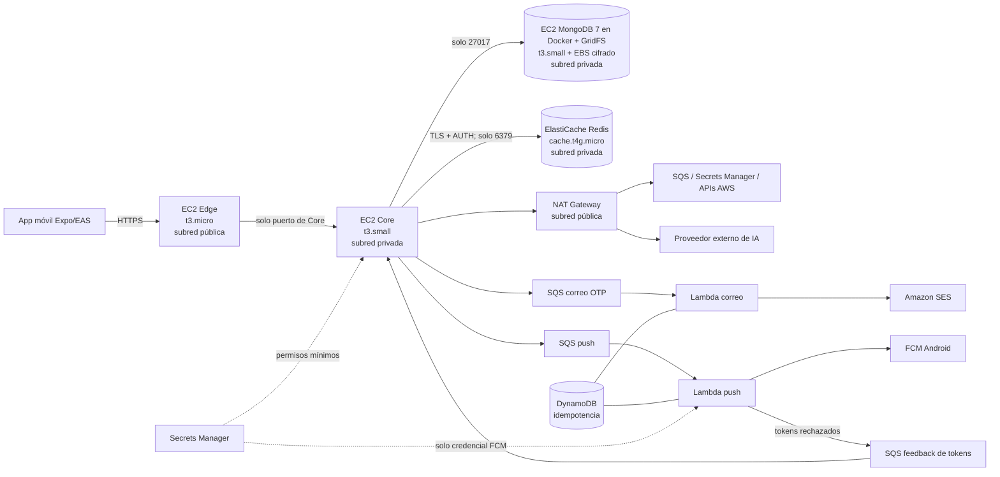

# Instrucciones para el agente de migración a AWS

## 1. Propósito y autoridad del documento

Este documento define la arquitectura aprobada y las instrucciones de implementación para migrar PokebO a AWS. Es la fuente de verdad para la primera migración de demostración.

Si otra documentación propone ECS/Fargate, un ALB o Redis dentro de la máquina del Core como primera etapa, prevalece este documento. Esos componentes solo podrán adoptarse posteriormente con una nueva estimación de costo y aprobación del equipo.

El objetivo es desplegar una versión funcional y segura para demostración, manteniendo compatibilidad con la aplicación actual y un gasto máximo aprobado de **USD 35** hasta el jueves 19 de noviembre de 2026.

## 2. Decisiones ya aprobadas

- Región seleccionada: `us-east-2` (Ohio).
- Rama de trabajo: `migracion-aws`.
- Entorno: demostración temporal, no producción.
- Presupuesto máximo para esta etapa: USD 35.
- Edge, Core y MongoDB se ejecutarán en instancias EC2 independientes.
- Redis se ejecutará en Amazon ElastiCache con el motor Redis exacto, no Valkey.
- Edge será el único punto de entrada público.
- Core, MongoDB y Redis estarán en subredes privadas.
- Se elimina `SERVICE_SHARED_SECRET`; el acceso Edge→Core se restringe mediante Security Groups.
- MongoDB conservará MongoDB 7, GridFS, índices y comportamiento actual.
- No se migrará MongoDB a Amazon DocumentDB en esta etapa.
- Correo: Core publica el OTP en SQS y una Lambda lo envía por SES.
- Push: Core publica el trabajo en SQS y una Lambda lo envía al proveedor correspondiente.
- Identificación de imágenes con IA: seguirá siendo síncrona.
- Secretos de servidor: AWS Secrets Manager, con permisos de mínimo privilegio.
- Infraestructura: AWS CDK v2 con TypeScript, desplegada mediante CloudFormation.
- No se usarán ECS, Fargate ni ALB en esta primera migración.
- La entrada HTTPS usará Caddy y un hostname `sslip.io` derivado de la Elastic IP de Edge.

Decisiones tomadas durante la implementación (2026-11-14, aprobadas por el equipo):

- Core, MongoDB y Redis comparten **una sola subred privada** (el aislamiento lo dan los Security Groups). Ya no hay subred de datos separada.
- MongoDB 7 corre en un **contenedor Docker** sobre su propia EC2 dedicada (imagen `mongo:7`, igual que `docker-compose.yml`).
- El plan de la cuenta es **FREE**: solo admite tipos de EC2 elegibles para Free Tier. `t3.medium` fue rechazado, así que MongoDB queda en `t3.small` (con 2 GiB de swap).
- Push **solo Android (FCM)**. iOS/APNs queda fuera de alcance de esta etapa (no hay credencial APNs).
- **No se crean alertas de presupuesto** ni **VPC Flow Logs** (decisión del equipo, proyecto académico). El gasto se revisa a mano en AWS Settings > Billing.
- Límite de gasto de la etapa: **USD 35** (antes USD 25).
- SES permanece en sandbox: solo se envía a destinatarios verificados (ver sección 10).
- El push de avistamiento cercano se activa al aceptar "Avisos de cercanía" en la app (`nearbyAlerts` + `pushEnabled`).
- Antes de la demo la app se deja "de cero": se conserva únicamente el catálogo de especies; se borran usuarios (incluidas las 4 cuentas del equipo), capturas y avisos.

## 3. Reglas obligatorias

1. Leer [AGENTS.md](./AGENTS.md), [README.md](./README.md), [docker-compose.yml](./docker-compose.yml) y este documento antes de cambiar código o infraestructura.
2. Trabajar únicamente en `migracion-aws`; no hacer `reset --hard`, force-push ni borrar cambios ajenos.
3. Crear todos los recursos regionales en `us-east-2`.
4. No usar Lambda@Edge, CloudFormation StackSets, replicación entre regiones, KMS multirregión ni recursos regionales fuera de `us-east-2`.
5. No crear credenciales AWS estáticas. EC2, Lambda y otros servicios deben usar roles IAM.
6. No imprimir ni copiar archivos `.env` reales completos. Para auditorías, inspeccionar únicamente los nombres de variables; solo se leen valores con autorización expresa del equipo y siempre sin mostrarlos (por ejemplo, para cargarlos en Secrets Manager).
7. No colocar secretos en Git, imágenes Docker, user data de EC2, outputs CDK, logs o plantillas CloudFormation.
8. Antes de cada despliegue ejecutar pruebas, `cdk synth`, controles de seguridad y `cdk diff`.
9. Mostrar el resultado de `cdk diff` y solicitar aprobación antes de `cdk deploy`.
10. Etiquetar los recursos con `Project=Pokebo`, `Environment=demo` y `ManagedBy=CDK`.
11. Mantener una estimación acumulada de costos y detenerse si la proyección puede superar USD 35.
12. Consultar antes de cualquier decisión importante, cambio de servicio o aumento de tamaño.

## 4. Arquitectura final de la demostración



El correo no usa Secrets Manager: la Lambda de correo solo necesita el rol IAM (SES) y el remitente verificado.

### Componentes

| Componente | Configuración inicial | Responsabilidad |
|---|---|---|
| Edge | EC2 `t3.micro`, 2 vCPU y 1 GiB | Entrada HTTPS, autenticación de borde, validación, rate limiting y proxy hacia Core |
| Core | EC2 `t3.small`, 2 vCPU y 2 GiB | Lógica de negocio y publicación de trabajos en SQS |
| MongoDB | EC2 `t3.small`, 2 vCPU y 2 GiB (+ 2 GiB de swap), contenedor Docker `mongo:7` | MongoDB 7, índices, documentos y GridFS; carga el catálogo de especies (691) al arrancar |
| Disco MongoDB | EBS `gp3`, cifrado, tamaño inicial 30 GiB | Persistencia de base de datos y archivos |
| Redis | ElastiCache Redis `cache.t4g.micro`, nodo único | OTP, sesiones, locks, TTL, H3 y datos temporales |
| NAT Gateway | Una unidad en la subred pública | Salida controlada desde las subredes privadas |
| Correo | SQS Standard + Lambda + SES | Envío asíncrono de OTP y recuperación de contraseña |
| Push | SQS Standard + Lambda | Envío asíncrono a FCM (Android) |
| Feedback de tokens | SQS Standard (+ DLQ) | La Lambda de push informa a Core los tokens que FCM rechazó; Core los retira de MongoDB |
| Idempotencia | DynamoDB bajo demanda | Evitar procesamiento repetido de eventos de workers |
| Secretos | Secrets Manager | Centralizar secretos de servidor |
| Imágenes | ECR | Imágenes Docker versionadas de Edge y Core |
| Operación | CloudWatch | Logs, métricas y alarmas |

## 5. Red y aislamiento

Crear una VPC en una sola zona de disponibilidad para esta demostración, con:

- una subred pública para Edge y NAT Gateway;
- una única subred privada para Core, MongoDB y ElastiCache (se unificaron las subredes de aplicación y de datos; el aislamiento entre ellos lo dan los Security Groups);
- Internet Gateway únicamente para la subred pública;
- salida de las subredes privadas mediante NAT Gateway.

Reglas mínimas de Security Groups:

| Origen | Destino | Puerto | Regla |
|---|---|---:|---|
| Internet | Edge | 443 | Permitido |
| Internet | Edge | 80 | Solo redirección a HTTPS o validación inicial del certificado |
| Edge | Core | Puerto de Core | Permitido |
| Core | MongoDB | 27017 | Permitido |
| Core | ElastiCache Redis | 6379 | Permitido con cifrado en tránsito |
| Cualquier otro origen | Core/MongoDB/Redis | Cualquiera | Denegado |

No abrir SSH. Administrar las instancias mediante AWS Systems Manager Session Manager. Las instancias deben usar IMDSv2 obligatorio y un hop limit compatible con contenedores.

Edge no debe conocer las direcciones de MongoDB o Redis. Core debe resolverse mediante su IP privada estable o DNS privado. MongoDB y Redis nunca tendrán endpoints públicos.

No recrear un secreto HMAC compartido en AWS. La barrera Edge→Core es la regla de Security Group por identidad de grupo, complementada por JWT, validación y rate limiting. Un compromiso total de Edge ya permitiría usar sus rutas autorizadas, por lo que copiar un secreto a Edge no reduce ese impacto.

## 6. Entrada HTTPS

Edge tendrá una Elastic IP estable. Al no usar ALB en esta etapa, Caddy se ejecutará en la instancia de Edge y publicará un hostname con formato `https://<ipv4-con-guiones>.sslip.io`.

Requisitos:

- HTTPS obligatorio y certificado válido para la URL configurada en EAS;
- redirección de HTTP a HTTPS y headers de seguridad;
- no exponer directamente el puerto interno del contenedor;
- documentar renovación del certificado y recuperación tras reinicio.
- mantener persistente el directorio de datos de Caddy para certificados;
- configurar Express con un solo proxy confiable para conservar la IP real usada por el rate limiting.

`sslip.io` actúa únicamente como DNS; no recibe ni termina el tráfico de la aplicación. Caddy termina TLS y reenvía hacia el contenedor Edge dentro de la misma instancia. Si la Elastic IP se libera, cambiarán el hostname y `EXPO_PUBLIC_API_URL`, por lo que se necesitará una nueva compilación o configuración remota de la app.

## 7. Secretos y configuración

### Secrets Manager

Separar secretos por consumidor o por límites de permisos. Como mínimo:

| Secreto (nombre en Secrets Manager) | Origen del valor | Consumidor permitido | Prohibido en |
|---|---|---|---|
| `pokebo/demo/mongo-root` | Generado por AWS | Solo la EC2 de MongoDB (arranque) | Edge, Core y app móvil |
| `pokebo/demo/mongo-app` | Generado por AWS | EC2 de MongoDB (crea el usuario) y Core | Edge y app móvil |
| `pokebo/demo/redis-auth` | Generado por AWS | Core (y ElastiCache, vía referencia dinámica de CloudFormation) | Edge y app móvil |
| `pokebo/demo/jwt-private-key` | Generada para AWS (distinta de la local) | Core | Edge y app móvil |
| `pokebo/demo/registration-code-pepper`, `pokebo/demo/login-code-pepper` | Generados por AWS | Core | Edge y app móvil |
| `pokebo/demo/fcm-service-account` | JSON de la cuenta de servicio de Firebase | Solo la Lambda de push | Edge, Core y app móvil |
| `pokebo/demo/ai-provider-key` | Clave que estaba en `edge-api/.env` | Core | Edge y app móvil |

La clave pública JWT no es secreta: está en el parámetro SSM `/pokebo/demo/jwt-public-key` y llega a Edge. Los secretos propios de AWS (MongoDB, Redis, peppers) se generan nuevos: no se migran valores del entorno local. Ningún valor secreto debe aparecer en logs, outputs CDK, user data, repositorio o imágenes.

### Aplicación móvil y EAS

- `EXPO_PUBLIC_API_URL`: URL HTTPS pública de Edge.
- `GOOGLE_MAPS_API_KEY`: secreto de compilación EAS restringido en Google Cloud por aplicación, package name y huella SHA.
- `google-services.json`: archivo secreto de EAS fuera de Git.
- Las credenciales privadas de FCM nunca deben incluirse en la app (`google-services.json` es solo configuración pública del cliente).

AWS no elimina la necesidad de una clave de Google Maps para una compilación Android.

## 8. MongoDB y GridFS

- Mantener MongoDB 7 y GridFS sin cambiar sus APIs.
- Ejecutar MongoDB en una EC2 privada independiente.
- Usar EBS `gp3` cifrado y montar el volumen fuera de la capa efímera del contenedor.
- Permitir conexiones únicamente desde el Security Group de Core.
- Activar autenticación de MongoDB.
- Obtener credenciales desde Secrets Manager durante el arranque sin incluirlas en user data.
- Configurar health check, restart policy y logs con redacción.
- Crear snapshot antes de la demostración y documentar restauración.
- Aplicar protección contra terminación y política de retención al volumen/snapshot de datos.

No migrar a DocumentDB ni MongoDB Atlas sin un proyecto separado de compatibilidad, costos y migración de datos.

## 9. ElastiCache Redis

- Utilizar el motor Redis exacto en un nodo `cache.t4g.micro`.
- Desplegarlo en la subred privada y permitir conexiones exclusivamente desde Core.
- Habilitar cifrado en tránsito y autenticación (AUTH token). Core se conecta con `rediss://` (TLS).
- Guardar las credenciales requeridas en Secrets Manager.
- No usar Redis como fuente duradera de verdad.
- Validar strings, hashes, sets, sorted sets, expiraciones, transacciones, scan y scripts Lua.
- Crear alarmas de uso de memoria, conexiones, CPU y evicciones.

El nodo no se puede detener como una EC2. Para cortar su costo debe eliminarse y recrearse mediante CDK. Como sus datos son temporales, la limpieza del entorno puede eliminarlo sin snapshot, previa aprobación.

## 10. Correo: Core → SQS → Lambda → SES

Flujo definitivo:

1. Core genera y persiste el OTP.
2. Core publica un mensaje versionado en una cola SQS Standard.
3. Lambda consume el evento y envía el correo mediante SES.
4. DynamoDB registra el identificador de entrega para reducir duplicados.
5. Los fallos recuperables se reintentan y los definitivos terminan en una DLQ.

Controles obligatorios:

- retirar Gmail SMTP y el envío de correo desde Edge;
- no devolver el objeto interno `delivery` a Edge;
- no registrar OTP, destinatarios completos ni cuerpos de mensajes;
- SQS cifrada y con TLS obligatorio;
- DLQ y alarma;
- visibility timeout al menos seis veces el timeout de Lambda;
- `ReportBatchItemFailures` para fallos parciales;
- concurrencia limitada, remitente SES verificado y consideración del sandbox de SES.

Estado: implementado y probado de punta a punta (envío, duplicado detectado, reintento ante rechazo de SES). Remitente verificado: `pokebouru@gmail.com`.

Sandbox de SES: la cuenta sigue en sandbox (límite de 200 correos al día) y **solo entrega a destinatarios verificados**. Para la demo están verificados los 4 correos del equipo; quien se registre con otra dirección no recibirá el código. No se solicitó salida de sandbox porque no es necesaria para la demo; si hiciera falta, se solicita en SES > Account dashboard > Request production access.

Desarrollo local: sin `OTP_EMAIL_QUEUE_URL` y credenciales AWS, el Core no puede publicar el OTP, por lo que el registro con correo no funciona con `docker compose` solo. Queda pendiente decidir un modo de desarrollo (por ejemplo, mostrar el código en consola).

## 11. Push: Core → SQS → Lambda → FCM (Android)

- Core conserva la selección geográfica mediante H3 y Redis.
- Core guarda la notificación interna y publica un evento versionado (`pokebo.push.requested`) con los tokens del destinatario, porque la Lambda no tiene acceso a MongoDB.
- Lambda push obtiene las credenciales desde Secrets Manager.
- **Alcance de esta etapa: solo Android (FCM).** Los tokens iOS se ignoran; APNs queda para una etapa posterior.
- Condición de envío: `nearbyAlerts` activo, `pushEnabled` activo y al menos un token Android. En la app, ambos se activan juntos al aceptar "Avisos de cercanía". No hay preferencias por categoría (el único evento con push es el avistamiento cercano).
- Si el push se publica, Core marca el avistamiento como visto para que el polling no muestre un segundo aviso local; si SQS falla, el aviso queda en el buzón y el polling lo muestra como antes.
- Tokens rechazados (`UNREGISTERED` / `INVALID_ARGUMENT`): la Lambda los devuelve por la cola `push-feedback` y Core los retira de MongoDB.
- Usar DLQ, cifrado, reintentos, fallos parciales, idempotencia y concurrencia limitada.
- Limitación conocida: ante un error recuperable (por ejemplo 503 de FCM) se reintenta el mensaje completo, por lo que un usuario con varios dispositivos podría recibir un duplicado.

Estado: implementado y probado con un token falso (la Lambda leyó la credencial real de Firebase, FCM lo rechazó y el token volvió por la cola de feedback). Falta probar un push real en un dispositivo Android con la compilación final.

La identificación de imágenes con IA no debe pasar por esta cola; permanece síncrona.

## 12. IA síncrona

- La identificación debe responder dentro de la solicitud original del cliente.
- La clave del proveedor no puede permanecer en Edge.
- Core invocará al proveedor a través del NAT Gateway con la credencial obtenida desde Secrets Manager.
- Mantener timeout, cancelación, límite de tamaño y manejo controlado de errores.
- No registrar imágenes, claves, URLs firmadas ni respuestas sensibles.
- Si el payload no cabe de forma segura, usar S3 privado temporal con expiración, previa aprobación.

Mover esta integración a una Lambda adaptadora queda como mejora posterior.

## 13. Infraestructura como código

Crear `infra/` con AWS CDK v2 y TypeScript.

```text
infra/
├── bin/
├── lib/
│   ├── config.ts              (hecho: región, AZ, CIDR, puertos, etiquetas)
│   ├── network-stack.ts       (hecho y desplegado)
│   ├── data-stack.ts          (hecho y desplegado)
│   ├── messaging-stack.ts     (hecho y desplegado)
│   ├── compute-stack.ts       (pendiente: ECR, Core, Edge, IP elástica, Caddy)
│   └── observability-stack.ts (pendiente: panel y alarmas restantes)
├── test/
├── cdk.json
├── package.json
└── README.md                  (pendiente: runbook)
```

Los secretos viven en el stack de datos, que tiene termination protection. Para borrarlo hay que desactivarla antes (`aws cloudformation update-termination-protection --no-enable-termination-protection`). El volumen de datos de MongoDB tiene política *Retain*: sobrevive al borrado del stack y hay que eliminarlo a mano si ya no se quiere.

Requisitos:

- fijar el entorno al proyecto autenticado y `us-east-2`;
- separar recursos con estado de los reemplazables;
- aplicar termination protection al stack de datos;
- usar roles separados y de mínimo privilegio;
- ECR con tags inmutables, escaneo y lifecycle policy; no usar `latest`;
- logs con retención explícita;
- integrar `cdk-nag` y justificar supresiones;
- tests de assertions para red, cifrado, IAM y exposición pública;
- ejecutar `cdk synth`, tests y `cdk diff` antes de desplegar;
- no usar `--hotswap` para el entorno compartido.

## 14. Presupuesto y controles de costo

Estimación recalculada el 2026-11-14 con precios reales de `us-east-2` (144 horas):

| Recurso | Precio por hora | Estimación |
|---|---:|---:|
| EC2 Edge `t3.micro` | 0,0104 | USD 1,50 |
| EC2 Core `t3.small` | 0,0208 | USD 3,00 |
| EC2 MongoDB `t3.small` | 0,0208 | USD 3,00 |
| ElastiCache Redis `cache.t4g.micro` | 0,0260 (el documento original asumía 0,016) | USD 3,74 |
| NAT Gateway | 0,045 | USD 6,48 |
| Dos IPv4 públicas (NAT y Edge) | 0,005 c/u | USD 1,44 |
| ~62 GiB EBS (16 + 30 de MongoDB, y raíces de Core y Edge) | | USD 0,98 |
| 10 GiB procesados por NAT | | USD 0,45 |
| Reserva para SES, Secrets Manager, ECR, logs y variaciones | | USD 2,00 |
| **Total previsto (144 h)** | | **USD 22,59** |

Con 120 horas el total ronda USD 19. El gasto real se revisa en Cost Explorer. Mientras solo estaban desplegadas red, datos y mensajería, el costo fijo era de unos USD 3 al día.

El límite aprobado es USD 35. Antes del despliegue:

- volver a consultar precios actuales de `us-east-2`;
- verificar el plan con `aws freetier get-account-plan-state` (la cuenta está en plan FREE con USD 100 de crédito; este plan **solo admite tipos de EC2 elegibles para Free Tier**: `t3.micro`, `t3.small`, `t4g.micro/small`, `t8i.micro/small`, `c7i-flex.large` y `m7i-flex.large`);
- revisar créditos y gasto en AWS Settings > Billing;
- ~~crear alertas de presupuesto~~: **decisión del equipo, no se crean**; el gasto se revisa a mano cada pocos días;
- configurar instancias T3 en modo `standard` para evitar cobros por CPU surplus;
- retener logs por un período corto y explícito;
- evitar transferencia innecesaria a través del NAT.

Un presupuesto de AWS genera alertas, pero no constituye un corte inmediato garantizado. Mantener margen y revisar el consumo diariamente.

## 15. Observabilidad y operación

- Logs estructurados con correlation ID y redacción de tokens, OTP, PII, claves e imágenes.
- Alarmas de estado EC2, CPU credits, disco MongoDB, memoria/evicciones Redis, DLQ, errores Lambda y errores 5xx. Hoy existen las 5 alarmas de mensajería (3 DLQ y 2 Lambdas, sin acciones de aviso); el resto está pendiente.
- Health checks de Edge, Core y MongoDB.
- Panel CloudWatch básico para la presentación.
- Runbook de arranque, parada, diagnóstico, backup, restauración y teardown.
- Acceso administrativo únicamente mediante Systems Manager.

## 16. Fases de implementación

### Fase 0 — Preflight

Estado: **completada** (identidad, región `us-east-2`, plan FREE con USD 100 de crédito, CDK inicializado, SES con remitente verificado).

- Confirmar identidad AWS, Región, plan, créditos y recursos existentes.
- Confirmar estado de la rama y pruebas base.
- Verificar SES y los servicios disponibles para el plan.
- Recalcular costos.

### Fase 1 — Código

Estado: **completada** (pruebas locales: core-api 48, edge-api 3, email-sender 5, push-sender 5, app 38). Pendiente menor: modo de desarrollo para el OTP sin SQS (ver sección 10).

- Completar el publicador SQS del Core y Lambda de correo con pruebas.
- Retirar SMTP y secretos de correo del Edge.
- Implementar contrato y worker de push.
- Mantener IA síncrona desde Core.
- Corregir TTL H3 y pruebas pendientes.
- Ejecutar todas las pruebas locales.

### Fase 2 — CDK sin desplegar

Estado: **parcial**. Hechos con pruebas (23), `cdk synth --strict` y `cdk-nag` sin hallazgos: red, datos y mensajería. Pendiente: cómputo (Core, Edge, ECR, IP elástica) y observabilidad.

- Crear stacks y tests.
- Ejecutar `cdk synth`, `cdk-nag` y `cdk diff`.
- Presentar recursos, permisos, exposición de red y costo actualizado.

**Detenerse y solicitar aprobación antes de `cdk deploy`.**

### Fase 3 — Red, datos y secretos

Estado: **desplegada y verificada** (`PokeboNetwork`, `PokeboData`). MongoDB sano con 691 especies, Redis disponible y cifrado, 8 de 8 secretos con valor. Pendiente: validar conexiones permitidas y denegadas desde Core, que aún no existe.

- Desplegar VPC, subredes, NAT y Security Groups.
- Desplegar MongoDB/EBS y ElastiCache Redis.
- Crear referencias de Secrets Manager sin imprimir valores.
- Validar conexiones permitidas y denegadas.

### Fase 4 — Mensajería y workers

Estado: **desplegada y probada** (`PokeboMessaging`): éxito, reintento ante rechazo de SES, idempotencia y token de push rechazado. Las DLQ quedaron vacías.

- Desplegar SQS, DLQ, DynamoDB, Lambda, SES y alarmas.
- Probar éxito, reintentos, idempotencia y DLQ.

### Fase 5 — Edge y Core

Estado: **desplegada y verificada** (`PokeboRegistry`, `PokeboCompute`). Imágenes construidas con Docker local y publicadas en ECR con tag inmutable mediante `infra/scripts/release.sh`; Core `t3.small` privado y Edge `t3.micro` público con IP elástica y Caddy.

URL pública: `https://18-191-90-176.sslip.io` (IP elástica `18.191.90.176`; **no liberarla** hasta después de la demo). Pruebas de humo superadas: `/health` por HTTPS con certificado válido, HTTP→HTTPS (308), headers de seguridad, Core/puertos 3000/4000/27017/6379 sin respuesta desde internet, 401 sin token en rutas protegidas y registro real de punta a punta (Edge → Core → Redis → SQS → Lambda → SES) con la dirección simulada de SES. Las imágenes actuales se construyeron con cambios sin commitear (tag `51266be-dirty-...`); conviene commitear y volver a publicar con `release.sh`.

- Publicar imágenes versionadas en ECR.
- Desplegar Core privado y después Edge público.
- Configurar HTTPS y ejecutar smoke tests.
- Confirmar que no existe acceso directo a Core o datos.

### Fase 6 — App y validación

- Configurar EAS y compilar la aplicación real.
- Probar autenticación, OTP, mapas, H3, imágenes, inbox y push.
- Registrar costos observados y limitaciones conocidas.

### Fase 7 — Limpieza

- Preguntar si el equipo quiere conservar o destruir los recursos.
- Detener EC2 si se conservarán temporalmente.
- Para detener el costo fijo, eliminar NAT Gateway y ElastiCache mediante CDK.
- Conservar datos únicamente mediante EBS/snapshot si se aprueba.
- Documentar qué recursos continúan generando costo.

## 17. Criterios de aceptación

- Edge es el único endpoint público y responde por HTTPS.
- Core solo acepta conexiones de Edge.
- MongoDB y Redis solo aceptan conexiones de Core.
- Core, MongoDB y Redis no tienen IP pública.
- No existen credenciales AWS estáticas ni secretos en Edge, Git, imágenes o logs.
- MongoDB 7 y GridFS funcionan sin migración implícita a DocumentDB.
- Correo usa Core → SQS → Lambda → SES.
- Push usa Core → SQS → Lambda → FCM (Android; iOS/APNs queda fuera de esta etapa).
- Los workers tienen DLQ, reintentos, fallos parciales e idempotencia.
- IA continúa síncrona y Maps funciona en una compilación Android con clave restringida.
- Las pruebas, `cdk synth`, `cdk-nag`, `cdk diff` y smoke tests pasan.
- Existe backup/restauración, rollback y teardown documentados.
- El costo proyectado permanece por debajo de USD 35.

## 18. Puntos de detención obligatoria

Solicitar aprobación antes de:

- ejecutar `cdk deploy`;
- aumentar tamaños o cantidades de instancias;
- agregar ALB, ECS, Fargate, réplicas o Multi-AZ;
- cambiar Redis por Valkey o MongoDB por DocumentDB/Atlas;
- hacer público Core, MongoDB o Redis;
- ampliar permisos IAM;
- superar la estimación o acercarse al límite de USD 35;
- borrar datos, volúmenes, snapshots, secretos o stacks;
- cambiar IA de síncrona a asíncrona;
- omitir un control de seguridad para cumplir la fecha.

## 19. Estado actual de la infraestructura (2026-11-14)

| Stack | Estado | Contenido |
|---|---|---|
| `CDKToolkit` | Desplegado | Recursos de arranque de CDK (bucket de assets, roles) |
| `PokeboNetwork` | Desplegado | VPC `10.20.0.0/16` en `us-east-2a`, subred pública y subred privada, NAT, IGW y 4 Security Groups (Edge, Core, MongoDB, Redis) |
| `PokeboData` (con termination protection) | Desplegado | 8 secretos, EC2 MongoDB (`t3.small`, Docker, IMDSv2), volumen de datos de 30 GiB cifrado (Retain), ElastiCache Redis |
| `PokeboMessaging` | Desplegado | 3 colas SQS con DLQ, tabla DynamoDB de idempotencia, 2 Lambdas (Node 26) y 5 alarmas |
| `PokeboRegistry` | Desplegado | 2 repositorios ECR (`pokebo-demo/core-api`, `pokebo-demo/edge-api`), tags inmutables |
| `PokeboCompute` | Desplegado | EC2 Core (privada) y Edge (pública), IP elástica `18.191.90.176`, Caddy, 3 grupos de logs |
| `PokeboObservability` | Pendiente | Panel CloudWatch y alarmas restantes |

Lo que sigue costando mientras exista, aunque se apaguen las EC2: NAT Gateway, ElastiCache, IPv4 públicas y EBS.

Pendientes conocidos:

- Dos correos del equipo siguen sin verificar en SES (`ariana.perez.estudio@gmail.com`, `Lautisiri@gmail.com`): cada persona debe abrir el enlace del correo de AWS.
- Runbook en `infra/README.md`: arranque/parada, reinicio "de cero" de la demo (conservar solo el catálogo), diagnóstico por Session Manager, backup y restauración con snapshot del volumen, teardown y rollback.
- Compilación Android con la URL final de Edge, clave de Google Maps restringida y prueba de push real en un dispositivo.

## 20. Posibles mejoras posteriores

- Migrar Edge y Core de EC2/Docker a ECS Fargate para despliegues administrados, rollback y escalado.
- Incorporar ALB + ACM y dominio propio para entrada HTTPS administrada.
- Distribuir el sistema en dos o más zonas de disponibilidad.
- Añadir réplica de ElastiCache y una estrategia de failover.
- Convertir MongoDB en un replica set o evaluar Atlas/DocumentDB tras pruebas de compatibilidad.
- Crear Auto Scaling para Edge/Core y despliegues blue/green.
- Sustituir NAT Gateway por endpoints VPC si los costos reales lo justifican.
- Mover la IA síncrona a una Lambda adaptadora o usar S3 temporal para imágenes grandes.
- Soporte de push en iOS (APNs, requiere cuenta Apple Developer) y preferencias de push por categoría.
- Salir del sandbox de SES para enviar a cualquier destinatario.
- Reactivar VPC Flow Logs y alertas de presupuesto si el entorno pasa de demostración.
- Añadir WAF, detección de amenazas y controles de seguridad avanzados.
- Automatizar CI/CD, backups, restauración, análisis de vulnerabilidades y teardown programado.
- Realizar una revisión AWS Well-Architected antes de considerar el sistema listo para producción.
