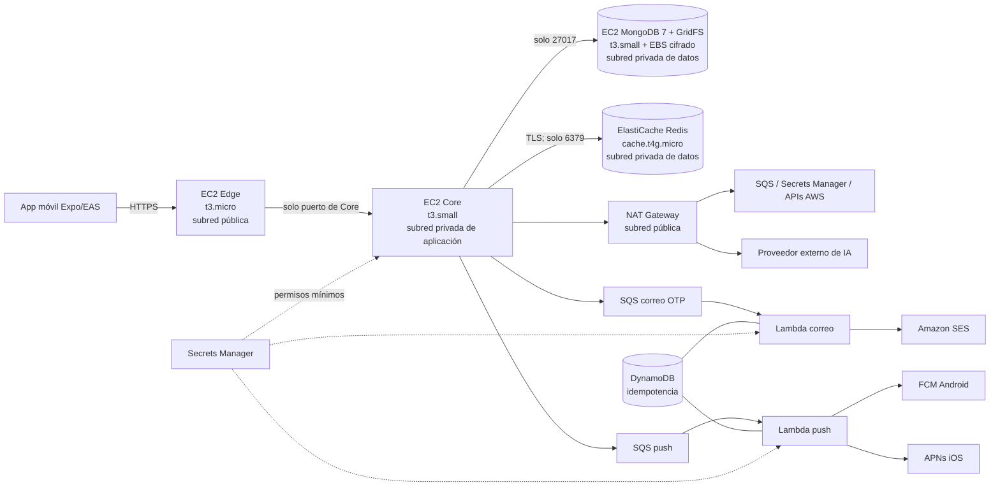

# Instrucciones para el agente de migración a AWS

## 1. Propósito y autoridad del documento

Este documento define la arquitectura aprobada y las instrucciones de implementación para migrar PokebO a AWS. Es la fuente de verdad para la primera migración de demostración.

Si otra documentación propone ECS/Fargate, un ALB o Redis dentro de la máquina del Core como primera etapa, prevalece este documento. Esos componentes solo podrán adoptarse posteriormente con una nueva estimación de costo y aprobación del equipo.

El objetivo es desplegar una versión funcional y segura para demostración, manteniendo compatibilidad con la aplicación actual y un gasto máximo aprobado de **USD 25** hasta el jueves 19 de noviembre de 2026.

## 2. Decisiones ya aprobadas

- Región seleccionada: `us-east-2` (Ohio).
- Rama de trabajo: `migracion-aws`.
- Entorno: demostración temporal, no producción.
- Presupuesto máximo para esta etapa: USD 25.
- Edge, Core y MongoDB se ejecutarán en instancias EC2 independientes.
- Redis se ejecutará en Amazon ElastiCache con el motor Redis exacto, no Valkey.
- Edge será el único punto de entrada público.
- Core, MongoDB y Redis estarán en subredes privadas.
- Se elimina `SERVICE_SHARED_SECRET`; el acceso Edge→Core se restringe mediante Security Groups.
- MongoDB conservará MongoDB 7, GridFS, índices y comportamiento actual.
- No se migrará MongoDB a Amazon DocumentDB en esta etapa.
- Correo: Core publica el OTP en SQS y una Lambda lo envía por SES.
- Push: Core publica el trabajo en SQS y una Lambda lo envía al proveedor correspondiente.
- Identificación de imágenes con IA: seguirá siendo síncrona.
- Secretos de servidor: AWS Secrets Manager, con permisos de mínimo privilegio.
- Infraestructura: AWS CDK v2 con TypeScript, desplegada mediante CloudFormation.
- No se usarán ECS, Fargate ni ALB en esta primera migración.
- La entrada HTTPS usará Caddy y un hostname `sslip.io` derivado de la Elastic IP de Edge.

## 3. Reglas obligatorias

1. Leer [AGENTS.md](./AGENTS.md), [README.md](./README.md), [docker-compose.yml](./docker-compose.yml) y este documento antes de cambiar código o infraestructura.
2. Trabajar únicamente en `migracion-aws`; no hacer `reset --hard`, force-push ni borrar cambios ajenos.
3. Crear todos los recursos regionales en `us-east-2`.
4. No usar Lambda@Edge, CloudFormation StackSets, replicación entre regiones, KMS multirregión ni recursos regionales fuera de `us-east-2`.
5. No crear credenciales AWS estáticas. EC2, Lambda y otros servicios deben usar roles IAM.
6. No leer, imprimir ni copiar archivos `.env` reales completos. Para auditorías, inspeccionar únicamente los nombres de variables.
7. No colocar secretos en Git, imágenes Docker, user data de EC2, outputs CDK, logs o plantillas CloudFormation.
8. Antes de cada despliegue ejecutar pruebas, `cdk synth`, controles de seguridad y `cdk diff`.
9. Mostrar el resultado de `cdk diff` y solicitar aprobación antes de `cdk deploy`.
10. Etiquetar los recursos con `Project=Pokebo`, `Environment=demo` y `ManagedBy=CDK`.
11. Mantener una estimación acumulada de costos y detenerse si la proyección puede superar USD 25.
12. Consultar antes de cualquier decisión importante, cambio de servicio o aumento de tamaño.

## 4. Arquitectura final de la demostración



### Componentes

| Componente | Configuración inicial | Responsabilidad |
|---|---|---|
| Edge | EC2 `t3.micro`, 2 vCPU y 1 GiB | Entrada HTTPS, autenticación de borde, validación, rate limiting y proxy hacia Core |
| Core | EC2 `t3.small`, 2 vCPU y 2 GiB | Lógica de negocio y publicación de trabajos en SQS |
| MongoDB | EC2 `t3.small`, 2 vCPU y 2 GiB | MongoDB 7, índices, documentos y GridFS |
| Disco MongoDB | EBS `gp3`, cifrado, tamaño inicial 30 GiB | Persistencia de base de datos y archivos |
| Redis | ElastiCache Redis `cache.t4g.micro`, nodo único | OTP, sesiones, locks, TTL, H3 y datos temporales |
| NAT Gateway | Una unidad en la subred pública | Salida controlada desde las subredes privadas |
| Correo | SQS Standard + Lambda + SES | Envío asíncrono de OTP y recuperación de contraseña |
| Push | SQS Standard + Lambda | Envío asíncrono a FCM/APNs |
| Idempotencia | DynamoDB bajo demanda | Evitar procesamiento repetido de eventos de workers |
| Secretos | Secrets Manager | Centralizar secretos de servidor |
| Imágenes | ECR | Imágenes Docker versionadas de Edge y Core |
| Operación | CloudWatch | Logs, métricas y alarmas |

## 5. Red y aislamiento

Crear una VPC en una sola zona de disponibilidad para esta demostración, con:

- una subred pública para Edge y NAT Gateway;
- una subred privada de aplicación para Core;
- una subred privada de datos para MongoDB y ElastiCache;
- Internet Gateway únicamente para la subred pública;
- salida de las subredes privadas mediante NAT Gateway.

Reglas mínimas de Security Groups:

| Origen | Destino | Puerto | Regla |
|---|---|---:|---|
| Internet | Edge | 443 | Permitido |
| Internet | Edge | 80 | Solo redirección a HTTPS o validación inicial del certificado |
| Edge | Core | Puerto de Core | Permitido |
| Core | MongoDB | 27017 | Permitido |
| Core | ElastiCache Redis | 6379 | Permitido con cifrado en tránsito |
| Cualquier otro origen | Core/MongoDB/Redis | Cualquiera | Denegado |

No abrir SSH. Administrar las instancias mediante AWS Systems Manager Session Manager. Las instancias deben usar IMDSv2 obligatorio y un hop limit compatible con contenedores.

Edge no debe conocer las direcciones de MongoDB o Redis. Core debe resolverse mediante su IP privada estable o DNS privado. MongoDB y Redis nunca tendrán endpoints públicos.

No recrear un secreto HMAC compartido en AWS. La barrera Edge→Core es la regla de Security Group por identidad de grupo, complementada por JWT, validación y rate limiting. Un compromiso total de Edge ya permitiría usar sus rutas autorizadas, por lo que copiar un secreto a Edge no reduce ese impacto.

## 6. Entrada HTTPS

Edge tendrá una Elastic IP estable. Al no usar ALB en esta etapa, Caddy se ejecutará en la instancia de Edge y publicará un hostname con formato `https://<ipv4-con-guiones>.sslip.io`.

Requisitos:

- HTTPS obligatorio y certificado válido para la URL configurada en EAS;
- redirección de HTTP a HTTPS y headers de seguridad;
- no exponer directamente el puerto interno del contenedor;
- documentar renovación del certificado y recuperación tras reinicio.
- mantener persistente el directorio de datos de Caddy para certificados;
- configurar Express con un solo proxy confiable para conservar la IP real usada por el rate limiting.

`sslip.io` actúa únicamente como DNS; no recibe ni termina el tráfico de la aplicación. Caddy termina TLS y reenvía hacia el contenedor Edge dentro de la misma instancia. Si la Elastic IP se libera, cambiarán el hostname y `EXPO_PUBLIC_API_URL`, por lo que se necesitará una nueva compilación o configuración remota de la app.

## 7. Secretos y configuración

### Secrets Manager

Separar secretos por consumidor o por límites de permisos. Como mínimo:

| Secreto | Consumidor permitido | Prohibido en |
|---|---|---|
| URI/credenciales MongoDB | Core | Edge y app móvil |
| Credenciales/autenticación Redis | Core | Edge y app móvil |
| Clave privada JWT | Core | Edge y app móvil |
| Peppers OTP | Core | Edge y app móvil |
| Credencial FCM/APNs | Lambda push | Edge, Core y app móvil |
| Clave del proveedor IA | Core o adaptador autorizado | Edge y app móvil |

La clave pública JWT puede llegar a Edge. Ningún valor secreto debe aparecer en logs, outputs CDK, user data, repositorio o imágenes.

### Aplicación móvil y EAS

- `EXPO_PUBLIC_API_URL`: URL HTTPS pública de Edge.
- `GOOGLE_MAPS_API_KEY`: secreto de compilación EAS restringido en Google Cloud por aplicación, package name y huella SHA.
- `google-services.json`: archivo secreto de EAS fuera de Git.
- Las credenciales privadas de FCM/APNs nunca deben incluirse en la app.

AWS no elimina la necesidad de una clave de Google Maps para una compilación Android.

## 8. MongoDB y GridFS

- Mantener MongoDB 7 y GridFS sin cambiar sus APIs.
- Ejecutar MongoDB en una EC2 privada independiente.
- Usar EBS `gp3` cifrado y montar el volumen fuera de la capa efímera del contenedor.
- Permitir conexiones únicamente desde el Security Group de Core.
- Activar autenticación de MongoDB.
- Obtener credenciales desde Secrets Manager durante el arranque sin incluirlas en user data.
- Configurar health check, restart policy y logs con redacción.
- Crear snapshot antes de la demostración y documentar restauración.
- Aplicar protección contra terminación y política de retención al volumen/snapshot de datos.

No migrar a DocumentDB ni MongoDB Atlas sin un proyecto separado de compatibilidad, costos y migración de datos.

## 9. ElastiCache Redis

- Utilizar el motor Redis exacto en un nodo `cache.t4g.micro`.
- Desplegarlo en la subred privada de datos y permitir conexiones exclusivamente desde Core.
- Habilitar cifrado en tránsito y autenticación.
- Guardar las credenciales requeridas en Secrets Manager.
- No usar Redis como fuente duradera de verdad.
- Validar strings, hashes, sets, sorted sets, expiraciones, transacciones, scan y scripts Lua.
- Crear alarmas de uso de memoria, conexiones, CPU y evicciones.

El nodo no se puede detener como una EC2. Para cortar su costo debe eliminarse y recrearse mediante CDK. Como sus datos son temporales, la limpieza del entorno puede eliminarlo sin snapshot, previa aprobación.

## 10. Correo: Core → SQS → Lambda → SES

Flujo definitivo:

1. Core genera y persiste el OTP.
2. Core publica un mensaje versionado en una cola SQS Standard.
3. Lambda consume el evento y envía el correo mediante SES.
4. DynamoDB registra el identificador de entrega para reducir duplicados.
5. Los fallos recuperables se reintentan y los definitivos terminan en una DLQ.

Controles obligatorios:

- retirar Gmail SMTP y el envío de correo desde Edge;
- no devolver el objeto interno `delivery` a Edge;
- no registrar OTP, destinatarios completos ni cuerpos de mensajes;
- SQS cifrada y con TLS obligatorio;
- DLQ y alarma;
- visibility timeout al menos seis veces el timeout de Lambda;
- `ReportBatchItemFailures` para fallos parciales;
- concurrencia limitada, remitente SES verificado y consideración del sandbox de SES.

## 11. Push: Core → SQS → Lambda → FCM/APNs

- Core conserva la selección geográfica mediante H3 y Redis.
- Core guarda la notificación interna y publica un evento versionado.
- Lambda push obtiene las credenciales desde Secrets Manager.
- Android usa FCM e iOS usa APNs.
- Respetar `pushEnabled`, `nearbyAlerts` y preferencias por categoría.
- Invalidar o retirar tokens rechazados por el proveedor.
- Usar DLQ, cifrado, reintentos, fallos parciales, idempotencia y concurrencia limitada.

La identificación de imágenes con IA no debe pasar por esta cola; permanece síncrona.

## 12. IA síncrona

- La identificación debe responder dentro de la solicitud original del cliente.
- La clave del proveedor no puede permanecer en Edge.
- Core invocará al proveedor a través del NAT Gateway con la credencial obtenida desde Secrets Manager.
- Mantener timeout, cancelación, límite de tamaño y manejo controlado de errores.
- No registrar imágenes, claves, URLs firmadas ni respuestas sensibles.
- Si el payload no cabe de forma segura, usar S3 privado temporal con expiración, previa aprobación.

Mover esta integración a una Lambda adaptadora queda como mejora posterior.

## 13. Infraestructura como código

Crear `infra/` con AWS CDK v2 y TypeScript.

```text
infra/
├── bin/
├── lib/
│   ├── network-stack.ts
│   ├── data-stack.ts
│   ├── messaging-stack.ts
│   ├── compute-stack.ts
│   └── observability-stack.ts
├── test/
├── cdk.json
├── package.json
└── README.md
```

Requisitos:

- fijar el entorno al proyecto autenticado y `us-east-2`;
- separar recursos con estado de los reemplazables;
- aplicar termination protection al stack de datos;
- usar roles separados y de mínimo privilegio;
- ECR con tags inmutables, escaneo y lifecycle policy; no usar `latest`;
- logs con retención explícita;
- integrar `cdk-nag` y justificar supresiones;
- tests de assertions para red, cifrado, IAM y exposición pública;
- ejecutar `cdk synth`, tests y `cdk diff` antes de desplegar;
- no usar `--hotswap` para el entorno compartido.

## 14. Presupuesto y controles de costo

Estimación aprobada para 144 horas:

| Recurso | Estimación |
|---|---:|
| EC2 Edge `t3.micro` | USD 1,50 |
| EC2 Core `t3.small` | USD 3,00 |
| EC2 MongoDB `t3.small` | USD 3,00 |
| ElastiCache Redis `cache.t4g.micro` | USD 2,30 |
| NAT Gateway | USD 6,48 |
| Dos IPv4 públicas | USD 1,44 |
| 58 GiB EBS | USD 0,92 |
| 10 GiB procesados por NAT | USD 0,45 |
| Reserva para SES, Secrets Manager, ECR, logs y variaciones | USD 2,00 |
| **Total previsto** | **USD 21,08** |

El límite aprobado es USD 25. Antes del despliegue:

- volver a consultar precios actuales de `us-east-2`;
- verificar el plan con `aws freetier get-account-plan-state`;
- revisar créditos y gasto en AWS Settings > Billing;
- crear alertas de presupuesto antes o junto al primer despliegue;
- configurar instancias T3 en modo `standard` para evitar cobros por CPU surplus;
- retener logs por un período corto y explícito;
- evitar transferencia innecesaria a través del NAT.

Un presupuesto de AWS genera alertas, pero no constituye un corte inmediato garantizado. Mantener margen y revisar el consumo diariamente.

## 15. Observabilidad y operación

- Logs estructurados con correlation ID y redacción de tokens, OTP, PII, claves e imágenes.
- Alarmas de estado EC2, CPU credits, disco MongoDB, memoria/evicciones Redis, DLQ, errores Lambda y errores 5xx.
- Health checks de Edge, Core y MongoDB.
- Panel CloudWatch básico para la presentación.
- Runbook de arranque, parada, diagnóstico, backup, restauración y teardown.
- Acceso administrativo únicamente mediante Systems Manager.

## 16. Fases de implementación

### Fase 0 — Preflight

- Confirmar identidad AWS, Región, plan, créditos y recursos existentes.
- Confirmar estado de la rama y pruebas base.
- Verificar SES y los servicios disponibles para el plan.
- Recalcular costos.

### Fase 1 — Código

- Completar el publicador SQS del Core y Lambda de correo con pruebas.
- Retirar SMTP y secretos de correo del Edge.
- Implementar contrato y worker de push.
- Mantener IA síncrona desde Core.
- Corregir TTL H3 y pruebas pendientes.
- Ejecutar todas las pruebas locales.

### Fase 2 — CDK sin desplegar

- Crear stacks y tests.
- Ejecutar `cdk synth`, `cdk-nag` y `cdk diff`.
- Presentar recursos, permisos, exposición de red y costo actualizado.

**Detenerse y solicitar aprobación antes de `cdk deploy`.**

### Fase 3 — Red, datos y secretos

- Desplegar VPC, subredes, NAT y Security Groups.
- Desplegar MongoDB/EBS y ElastiCache Redis.
- Crear referencias de Secrets Manager sin imprimir valores.
- Validar conexiones permitidas y denegadas.

### Fase 4 — Mensajería y workers

- Desplegar SQS, DLQ, DynamoDB, Lambda, SES y alarmas.
- Probar éxito, reintentos, idempotencia y DLQ.

### Fase 5 — Edge y Core

- Publicar imágenes versionadas en ECR.
- Desplegar Core privado y después Edge público.
- Configurar HTTPS y ejecutar smoke tests.
- Confirmar que no existe acceso directo a Core o datos.

### Fase 6 — App y validación

- Configurar EAS y compilar la aplicación real.
- Probar autenticación, OTP, mapas, H3, imágenes, inbox y push.
- Registrar costos observados y limitaciones conocidas.

### Fase 7 — Limpieza

- Preguntar si el equipo quiere conservar o destruir los recursos.
- Detener EC2 si se conservarán temporalmente.
- Para detener el costo fijo, eliminar NAT Gateway y ElastiCache mediante CDK.
- Conservar datos únicamente mediante EBS/snapshot si se aprueba.
- Documentar qué recursos continúan generando costo.

## 17. Criterios de aceptación

- Edge es el único endpoint público y responde por HTTPS.
- Core solo acepta conexiones de Edge.
- MongoDB y Redis solo aceptan conexiones de Core.
- Core, MongoDB y Redis no tienen IP pública.
- No existen credenciales AWS estáticas ni secretos en Edge, Git, imágenes o logs.
- MongoDB 7 y GridFS funcionan sin migración implícita a DocumentDB.
- Correo usa Core → SQS → Lambda → SES.
- Push usa Core → SQS → Lambda → FCM/APNs.
- Los workers tienen DLQ, reintentos, fallos parciales e idempotencia.
- IA continúa síncrona y Maps funciona en una compilación Android con clave restringida.
- Las pruebas, `cdk synth`, `cdk-nag`, `cdk diff` y smoke tests pasan.
- Existe backup/restauración, rollback y teardown documentados.
- El costo proyectado permanece por debajo de USD 25.

## 18. Puntos de detención obligatoria

Solicitar aprobación antes de:

- ejecutar `cdk deploy`;
- aumentar tamaños o cantidades de instancias;
- agregar ALB, ECS, Fargate, réplicas o Multi-AZ;
- cambiar Redis por Valkey o MongoDB por DocumentDB/Atlas;
- hacer público Core, MongoDB o Redis;
- ampliar permisos IAM;
- superar la estimación o acercarse al límite de USD 25;
- borrar datos, volúmenes, snapshots, secretos o stacks;
- cambiar IA de síncrona a asíncrona;
- omitir un control de seguridad para cumplir la fecha.

## 19. Posibles mejoras posteriores

- Migrar Edge y Core de EC2/Docker a ECS Fargate para despliegues administrados, rollback y escalado.
- Incorporar ALB + ACM y dominio propio para entrada HTTPS administrada.
- Distribuir el sistema en dos o más zonas de disponibilidad.
- Añadir réplica de ElastiCache y una estrategia de failover.
- Convertir MongoDB en un replica set o evaluar Atlas/DocumentDB tras pruebas de compatibilidad.
- Crear Auto Scaling para Edge/Core y despliegues blue/green.
- Sustituir NAT Gateway por endpoints VPC si los costos reales lo justifican.
- Mover la IA síncrona a una Lambda adaptadora o usar S3 temporal para imágenes grandes.
- Añadir WAF, detección de amenazas y controles de seguridad avanzados.
- Automatizar CI/CD, backups, restauración, análisis de vulnerabilidades y teardown programado.
- Realizar una revisión AWS Well-Architected antes de considerar el sistema listo para producción.
